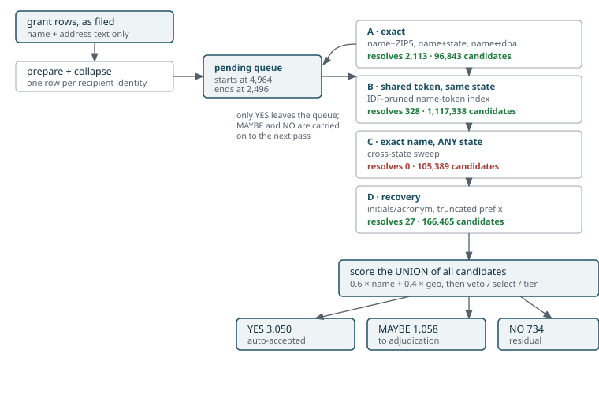

```{r setup, include = FALSE}
knitr::opts_chunk$set(collapse = TRUE, comment = "#>", echo = FALSE)
fmt <- function(x) formatC(x, big.mark = ",", format = "d")
tab <- function(d, ...) knitr::kable(d, format = "html", ...)
```

```{r data}
# Captured from a real run: data-dev/BENCH-EFILEPF-augmented.rds, 5,000 grant
# rows from the NCCS e-file samples against the augmented unified reference
# (3,880,431 rows), 11 passes. Embedded as literal values so this vignette
# builds without the reference or a cascade run.
# Regenerate with dev/build-vignette-examples.R.
stage_tbl <- data.frame(
  pass = c("A1-name-zip5", "A2-name-state", "A3-name-dba", "A4-dba-name",
           "B1-token-state", "B2-token-concat", "C1-name-any", "C2-dba-any",
           "D1-acronym", "D2-prefix"),
  criteria = c("name + ZIP5 (exact)", "name + state (exact)",
               "name == dba, same state", "dba == name, same state",
               "shared token, same state", "shared token + compound, same state",
               "name == name, ANY state", "name == dba, ANY state",
               "shared token incl. initials", "name prefix + ZIP5"),
  candidates = c(16093L, 79930L, 793L, 27L, 364656L, 752682L, 103442L, 1947L,
                 166447L, 18L),
  resolved = c(1590L, 423L, 89L, 11L, 275L, 53L, 0L, 0L, 25L, 2L),
  pending  = c(3374L, 2951L, 2862L, 2851L, 2576L, 2523L, 2523L, 2523L, 2498L, 2496L),
  stringsAsFactors = FALSE)

tier_by_pass <- data.frame(
  pass  = c("A1-name-zip5", "A2-name-state", "A3-name-dba", "A4-dba-name",
            "B1-token-state", "B2-token-concat", "C1-name-any", "C2-dba-any",
            "D1-acronym", "D2-prefix"),
  YES   = c(2092L, 503L, 73L, 13L, 314L, 49L, 1L, 0L, 4L, 1L),
  MAYBE = c(293L, 119L, 29L, 0L, 395L, 54L, 152L, 0L, 16L, 0L),
  NO    = c(0L, 0L, 0L, 0L, 547L, 60L, 50L, 13L, 61L, 0L),
  stringsAsFactors = FALSE)

cases <- data.frame(
  pass = c("A1-name-zip5","A1-name-zip5","A1-name-zip5","A1-name-zip5",
           "A2-name-state","A2-name-state","A2-name-state","A2-name-state",
           "A3-name-dba","A3-name-dba","A3-name-dba","A3-name-dba",
           "A4-dba-name","A4-dba-name",
           "B1-token-state","B1-token-state","B1-token-state","B1-token-state",
           "B2-token-concat","B2-token-concat","B2-token-concat","B2-token-concat",
           "C1-name-any","C1-name-any","C1-name-any","C2-dba-any","C2-dba-any",
           "D1-acronym","D1-acronym","D1-acronym","D1-acronym","D2-prefix"),
  role = c("carried forward","carried forward","clears (hard)","clears (regular)",
           "carried forward","carried forward","clears (hard)","clears (regular)",
           "carried forward","carried forward","clears (hard)","clears (regular)",
           "clears (hard)","clears (regular)",
           "carried forward","carried forward","clears (hard)","clears (regular)",
           "carried forward","carried forward","clears (hard)","clears (regular)",
           "carried forward","carried forward","clears (regular)",
           "carried forward","carried forward",
           "carried forward","carried forward","clears (hard)","clears (regular)",
           "clears (regular)"),
  tier = c("MAYBE","MAYBE","YES","YES","MAYBE","MAYBE","YES","YES","MAYBE","MAYBE",
           "YES","YES","YES","YES","MAYBE","MAYBE","YES","YES","MAYBE","MAYBE",
           "YES","YES","MAYBE","MAYBE","YES","NO","NO","MAYBE","MAYBE","YES","YES","YES"),
  filed = c("ST SAHAG ARMENIAN CHURCH","ST PETERS HOSPITAL FOUNDATION",
            "METROPOLITAN OPERA GUILD INC","SAN FRANCISCO SYMPHONY",
            "NASHVILLE BALLET","Wake Forest University","CARNEGIE MELLON UNIVERSITY",
            "ZOOLOGICAL SOCIETY OF MILW","UNIVERSITY OF MONTANA","SUMMA FOUNDATION",
            "SYRACUSE UNIVERSITY","ARABIA SHRINERS","ST JUDE'S CHILDREN'S RESEARCH",
            "SANTA BARBARA TRUST FOR HISTORIC","BOYS AND GIRLS CLUB OF TAMPA BAY INC",
            "DENTAL LIFELINE NETWORK","AMERICAN FRIENDS OF MAGEN DAVID ADOM",
            "Friends of South Georgia Is","CAPITAL AREA FOODBANK",
            "UNITED NATIONS ASSOCIATION OF USA","INTERNATIONAL CITY THEATRE (ICT)",
            "CARBON180","HARRY S TRUMAN LIBRARY INSTITUTE","MAKE A WISH FOUNDATION",
            "NATIONAL WORLD WAR II MUSEUM","HIGHER GROUND","ROSARY ACADEMY",
            "CONGREGATION SHAARE TEFILAH","ART FOR AUTISM","ST JOHN'S LUTHERAN CHILDCARE",
            "ACCESS SPORTS AMERICA","UKRAINIAN CATHOLIC EDUCATION FOUNDA"),
  state = c("MN","NY","NY","CA","TN","NC","PA","WI","MT","OH","NY","TX","TN","CA",
            "FL","CO","NY","CO","DC","NY","CA","DC","VA","OH","CO","ID","CA","NY",
            "FL","NY","MA","NY"),
  matched = c("SAINT SAHAG ARMENIAN CHURCH","SAINT PETERS HOSPITAL FOUNDATION",
              "METROPOLITAN OPERA GUILD","SAN FRANCISCO SYMPHONY","NASHVILLE BALLET",
              "WAKE FOREST UNIVERSITY","CARNEGIE MELLON UNIVERSITY",
              "ZOOLOGICAL SOCIETY OF MILW","University Of Montana","Summa Foundation",
              "Syracuse University","Arabia Shriners","SAINT JUDES CHILDRENS RESEARCH HOSPITAL",
              "SANTA BARBARA TRUST FOR HISTORIC PRESERVATION","BOYS AND GIRLS CLUBS OF TAMPA BAY",
              "Dental Lifeline Network-Nc","AMERICAN FRIENDS OF MAGEN DAVID ADO",
              "FRIENDS OF SOUTH GEORGIA ISLAND","CAPITAL AREA FOOD BANK",
              "UNITED NATIONS ASSOCIATION OF THE USA","INTERNATIONAL CITY THEATRE",
              "CARBON 180","HARRY S TRUMAN LIBRARY INSTITUTE","MAKE A WISH",
              "NATIONAL WORLD WAR II MUSEUM","Higher Ground","Rosary Academy",
              "CONGREGATION SHAARA TEFILLE","ARTS FOR AUTISM FOUNDATION",
              "SAINT JOHN LUTHERAN CHURCH","ACCESS SPORT AMERICA",
              "UKRAINIAN CATHOLIC EDUCATION FOUNDATION"),
  score = c(0.980,0.980,0.960,0.980,0.980,0.980,0.900,0.980,0.980,0.980,0.960,0.980,
            0.960,0.980,0.974,0.966,0.954,0.954,0.971,0.958,0.953,0.960,0.720,0.720,
            0.980,0.600,0.600,0.900,0.900,0.896,0.970,0.940),
  margin = c(0.000,0.020,0.050,0.980,0.000,0.000,0.080,0.980,0.000,0.000,0.060,0.980,
             0.061,0.980,0.000,-0.014,0.054,0.954,0.000,0.000,0.066,0.960,0.070,0.000,
             0.900,0.000,0.520,0.000,0.255,0.132,0.750,0.860),
  name_sim = c(1.000,1.000,1.000,1.000,1.000,1.000,1.000,1.000,1.000,1.000,1.000,
               1.000,1.000,1.000,0.990,0.977,0.991,0.957,0.985,0.964,0.956,0.967,
               1.000,1.000,1.000,1.000,1.000,0.962,0.978,0.894,0.984,0.933),
  stringsAsFactors = FALSE)

show <- function(p) {
  d <- cases[cases$pass == p, c("role", "tier", "filed", "state", "matched",
                                "score", "margin")]
  names(d) <- c("role", "tier", "filed name", "st", "matched BMF name", "score", "margin")
  tab(d, row.names = FALSE)
}
```

A 990-PF filer types a grantee's name into Part XIV Table 3a by hand. There is
no EIN, the name is often abbreviated or misspelled, and the address may be the
grantee's headquarters, a program site, a lockbox, or the foundation's own
office. `pfmatch` recovers the recipient's EIN by running that text against the
IRS Business Master File through a **staged cascade**: a sequence of blocking
passes that start tight and loosen, each one only looking at what the previous
passes could not settle.

This article walks the passes in order and shows, for each, real cases that
clear and real cases that are carried forward. Every number and name below comes
from one run — 5,000 grant rows against the augmented unified reference
(3,880,431 rows) — not from illustration.

## The shape of it



Two mechanics matter more than the pass list, and both are easy to get wrong.

**Only YES leaves the queue.** After each pass, `np_cascade()` removes a query
from `pending` *only* if it reached the YES tier. MAYBE and NO stay in, so later
and looser passes keep adding candidates for them. The queue goes
`r fmt(4964)` → `r fmt(2496)` over the ten passes that fire.

**The final decision is made over the union, not pass by pass.** Every pass's
scored pairs are accumulated; at the end they are de-duplicated by
`(query, EIN)`, keeping the tightest pass that produced each, and
`np_select()` / `np_tier()` run once over that union. So a pass can *generate*
the winning candidate without being the pass that resolved the case.

That distinction explains an apparent contradiction between the two tables
below. Pass C1 resolves **zero** queries at the moment it runs, yet one case is
finally attributed to it — the candidate C1 generated won after later passes had
contributed theirs.

### What each pass cost and resolved

```{r stages}
d <- stage_tbl
d$candidates <- fmt(d$candidates)
names(d) <- c("pass", "blocks on", "candidates", "resolved here", "still pending")
tab(d, row.names = FALSE)
```

### Final tier, by the pass that generated the winning candidate

```{r tbp}
d <- tier_by_pass
d$total <- d$YES + d$MAYBE + d$NO
tab(d, row.names = FALSE)
```

Read the two together and the cascade's economics are stark. Stage A buys
`r fmt(2113)` resolutions for `r fmt(96843)` candidates. Stage B buys 328 for
1.1 million. Stage C buys **nothing at all** for 105,389 — and that is not bad
luck, it is structural; see *Why cross-state passes cannot clear* below.

## How a case is scored

Blocking only decides which pairs get *looked at*. The decision is:

```
score = 0.6 x name + 0.4 x geo
geo   = max(zip9 1.00, street 0.95, zip5 0.90, pobox 0.90,
            zip3 0.55, city 0.50, state 0.20)

YES    score >= 0.78  AND  margin >= 0.05
MAYBE  score >= 0.65
NO     below that
```

`margin` is the gap to the runner-up. It is the second half of the YES rule and
it does most of the work of carrying cases forward, as the examples show.

Name similarity is floored: below `jw_threshold` (0.85) it contributes **zero**
rather than a small amount, so a name that is merely not-very-similar is treated
as no evidence at all.

## Stage A — exact

Four passes, each an exact join on a composite key, differing in which key and
which name version. They are cheap, they are the most precise thing available,
and they do most of the work.

### A1 · name + ZIP5

The tightest pass in the cascade: the normalized name and the 5-digit ZIP must
both match exactly.

```{r a1}
show("A1-name-zip5")
```

`SAN FRANCISCO SYMPHONY` is the regular case — exact name, exact ZIP, nothing
else close, margin 0.98.

`METROPOLITAN OPERA GUILD INC` is the hard version of the *same* shape. The name
matches exactly after the corporate suffix is stripped, but the Metropolitan
Opera family has several similarly named entities in one ZIP, so the margin
falls to exactly 0.05 — the threshold. One notch lower and it would not have
cleared.

The two carried-forward cases are the pattern worth internalising: **both score
0.98 with a perfect name similarity, and are MAYBE anyway.**
`ST SAHAG ARMENIAN CHURCH` matched `SAINT SAHAG ARMENIAN CHURCH` with
`name_sim = 1.000`, and its margin is **0.000** — a second reference row scored
identically. Nothing is wrong with the name; there are simply two candidates the
evidence cannot separate. That is a tie, not a failure, and it is the single
most common reason a tight pass hands a case onward.

### A2 · name + state

Loosens the geography from ZIP5 to state, which widens the candidate pool
roughly fivefold (`r fmt(79930)` candidates against `r fmt(16093)`).

```{r a2}
show("A2-name-state")
```

`CARNEGIE MELLON UNIVERSITY` is the instructive clear. Score 0.900, not 0.98 —
the name is exact but only the *state* corroborates, so geo contributes
`0.4 x 0.50` rather than `0.4 x 0.90`. It still clears because the margin is
0.08.

`NASHVILLE BALLET` and `Wake Forest University` are carried forward on margin
0.000 again, and both have exact names. A state-level match cannot separate a
university from its own foundation or medical centre.

### A3 / A4 · the DBA cross-products

A3 matches the filed name against the reference's **DBA**; A4 matches a filed
DBA against the reference's legal name. These recover organisations that
transact under a name that is not their legal one.

```{r a3}
show("A3-name-dba")
```

```{r a4}
show("A4-dba-name")
```

`ST JUDE'S CHILDREN'S RESEARCH` → `SAINT JUDES CHILDRENS RESEARCH HOSPITAL` is
the characteristic A4 case: the filed string is the familiar public name, the
reference row carries the legal one, and only the DBA path connects them.

A5 (`dba == dba`) produced **no candidates at all** on this run. It is retained
because it costs nothing when it does not fire.

## Stage B — shared token, same state

Where exactness fails, B blocks on a shared *name token* within state, using an
inverted index with IDF-weighted pruning: a pair is kept only if its shared
tokens carry enough information (`min_pair_idf = 8`), and tokens appearing in
more than 25,000 reference records are dropped entirely. This is what makes the
cascade scale — without it, every query would be compared against every
same-state organisation.

```{r b1}
show("B1-token-state")
```

```{r b2}
show("B2-token-concat")
```

B is where the first genuinely *wrong* answers appear, and where NO becomes a
real outcome (547 and 60 cases). Two carried-forward cases show different
mechanisms:

- `BOYS AND GIRLS CLUB OF TAMPA BAY INC` → `BOYS AND GIRLS CLUBS OF TAMPA BAY`
  at 0.974 with margin **0.000**. Almost certainly correct, held back by a tie —
  a chapter federation has many near-identical rows.
- `DENTAL LIFELINE NETWORK` → `Dental Lifeline Network-Nc` with margin
  **−0.014**. A *negative* margin: the runner-up outscored the chosen candidate
  after the tie-break. The filer named the national body; the state affiliate
  scored higher. No amount of name similarity resolves that — it needs the
  grant's purpose or the funder's geography.

B2 adds de-spaced compounds as extra tokens, which is how `CARBON180` reaches
`CARBON 180` and `CAPITAL AREA FOODBANK` reaches `CAPITAL AREA FOOD BANK`.

## Stage C — exact name, any state

C drops the state requirement entirely, for the case where the filed address is
a lockbox or the funder's own office rather than the grantee's.

```{r c1}
show("C1-name-any")
```

```{r c2}
show("C2-dba-any")
```

### Why cross-state passes cannot clear

C1 and C2 generate 105,389 candidates and resolve **zero**. The reason is
arithmetic, not data:

A cross-state pair has no geographic corroboration. The state conflict gate
zeroes the city and ZIP3 terms deliberately — a shared city name across two
states is a coincidence of naming, not evidence — so `geo = 0` and

```
score = 0.6 x name + 0.4 x 0  <=  0.600
```

**0.600 is below the 0.65 MAYBE floor**, let alone the 0.78 YES threshold. A
*perfect* cross-state name match cannot reach MAYBE on its own. `HIGHER GROUND`
and `ROSARY ACADEMY` both sit at exactly 0.600 with `name_sim = 1.000` and are
NO. `HARRY S TRUMAN LIBRARY INSTITUTE` reaches 0.720 only because its state
term fires.

So stage C does not function as an acceptance pass. It functions as a
*candidate supplier* for adjudication: 152 cases finally attributed to C1 are
MAYBE, meaning the cross-state candidate it surfaced became the best available
answer once a reviewer looks. Whether 105,389 candidates is a fair price for 152
review candidates is a live question — a related unblocked token pass (`C3`) was
measured and rejected for yielding zero YES.

## Stage D — recovery

D runs last, on whatever remains, and addresses two specific filing habits.

**D1 · acronym.** Blocks on `name_acro`, which is the name key *plus* the
record's initials, so `ICT` can meet `INTERNATIONAL CITY THEATRE` and `UCAP` can
meet `URBAN COLLABORATIVE ACCELERATED PROGRAM`.

**D2 · truncated prefix.** Blocks on the first 18 characters of the name plus an
exact ZIP5. The prefix alone is far too blunt — `AMERICAN ASSOCIATION OF
PRO-LIFE OBSTETRICIANS` and `AMERICAN ASSOCIATION OF ZOO KEEPERS` share one —
so it is paired with the ZIP, and on the query side it fires only for names the
parser flagged as actually cut off.

```{r d1}
show("D1-acronym")
```

```{r d2}
show("D2-prefix")
```

`ACCESS SPORTS AMERICA` → `ACCESS SPORT AMERICA` (singular/plural) and
`ST JOHN'S LUTHERAN CHILDCARE` → `SAINT JOHN LUTHERAN CHURCH` are the regular
and hard versions: the first is a one-character difference with a 0.75 margin;
the second clears at 0.896 on a name similarity of only 0.894, carried by a
strong address match, and is the kind of case where the *childcare* programme and
the *church* may or may not be the same filer-intended payee.

`CONGREGATION SHAARE TEFILAH` → `CONGREGATION SHAARA TEFILLE` is a
transliteration difference — two vowels — carried forward on a 0.000 margin
because several transliterations of the same congregation name exist.

## Why cases do not clear

Across all the carried-forward examples, three mechanisms account for nearly
everything, and only the third is what most people picture:

1. **Ties.** Score is high, `name_sim` is often exactly 1.000, and `margin` is
   0.000. The right answer may well be in the list; the evidence cannot single
   it out. Dominant at stages A and B.
2. **The structural cap.** No geographic corroboration means the score cannot
   exceed 0.600, so the case cannot reach MAYBE however good the name. Dominant
   at stage C.
3. **Genuine ambiguity.** Parent against chapter, institution against its own
   foundation, operating entity against its endowment. These have two defensible
   answers and no amount of string comparison settles them.

This is why there is no automatic acceptance of the MAYBE tier. A rule of
"ZIP5 agrees and margin ≥ 0.05" was measured at 100% precision on 18 cases, then
at **72%** on 200 fresh ones — because 79% of the cases it fired on were
token-overlap matches, which the scorer deliberately caps below YES precisely
because containment cannot separate a parent from a chapter.

## What happens next

`pf_adjudicate()` builds the review sheet: per candidate, the BMF name and
address, NTEE code and definition, activity text, subsection and assets, plus
the grant purpose and the filing foundation's own NTEE and state — and, for
every candidate rather than only the top pick, the NTEEv2 description and the
Form 990 Part III mission and programme text. Adding that text was measured to
resolve 45 of 56 hard cases.

Two things to know before using it:

- **`NONE` is a correct and common answer.** In a labelled sample, 24 of 82 hard
  cases had no correct candidate in the list at all. A reviewer who assumes one
  of the five is right manufactures false positives.
- **Prioritise by dollars.** Grant amounts are heavily skewed; roughly 740
  reviews covers 70% of the recoverable unresolved dollars.

To score a configuration rather than argue about its clear rate, see
`pf_evaluate()` and `pf_consistency()`.
